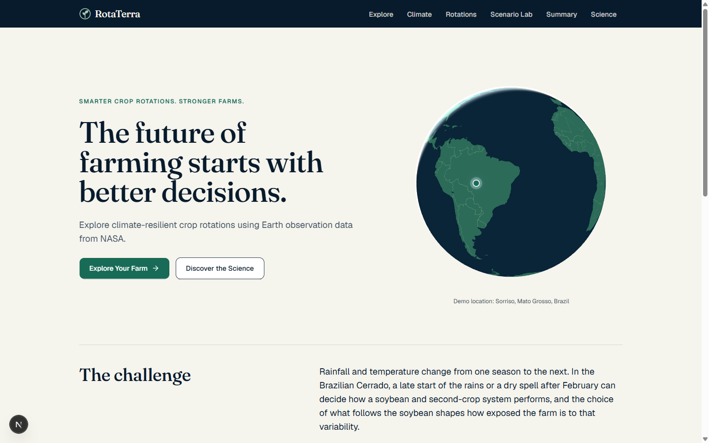
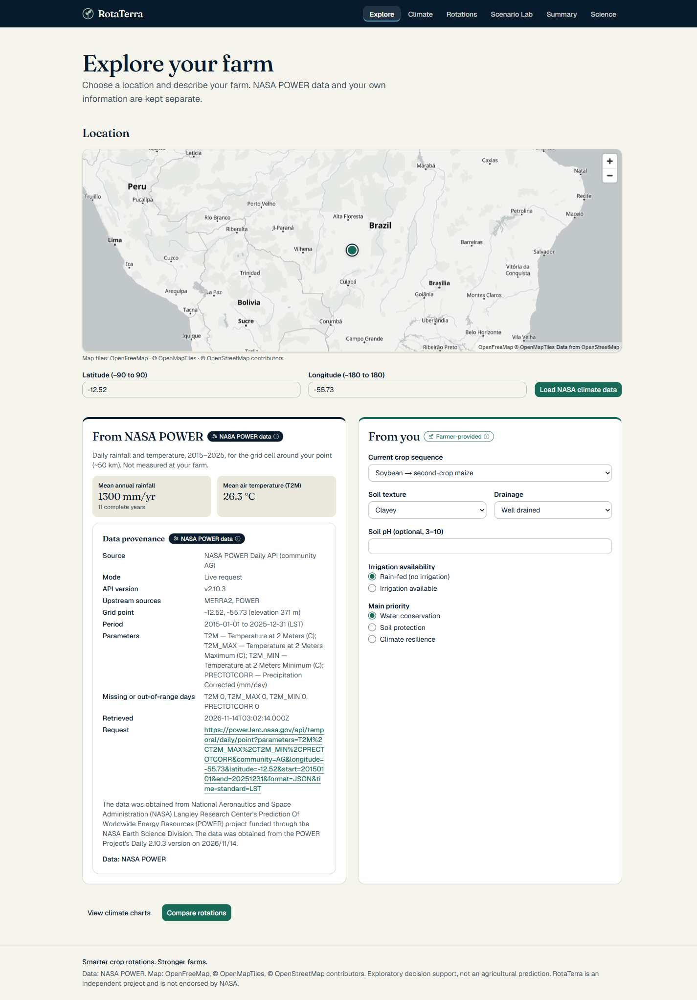
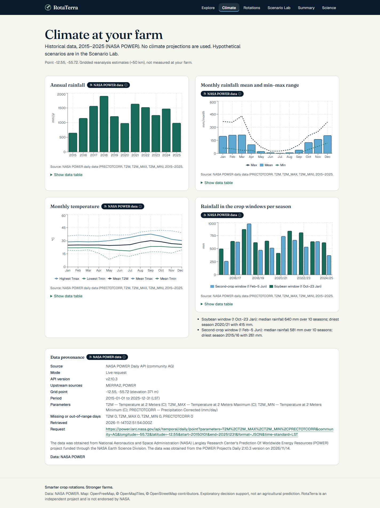
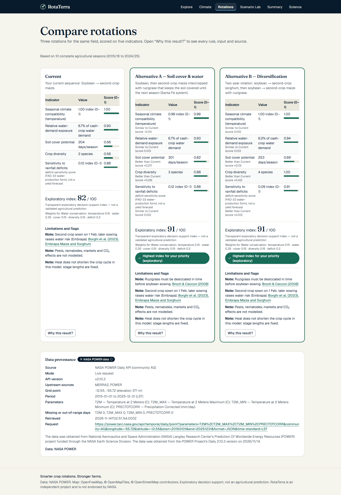
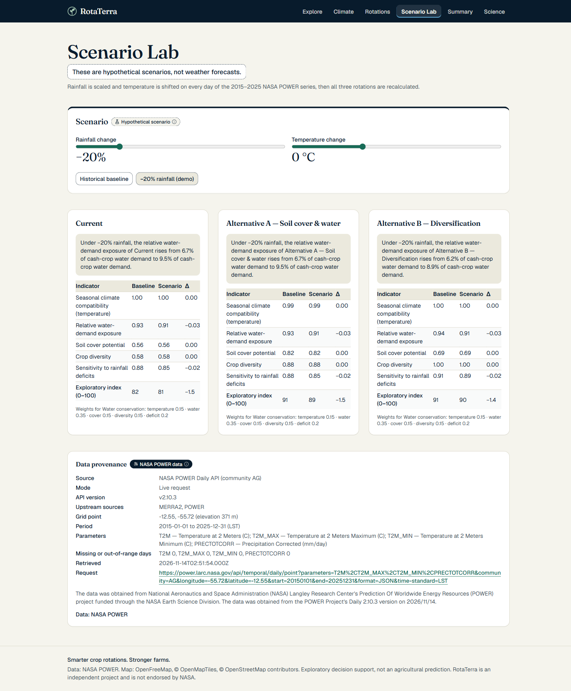
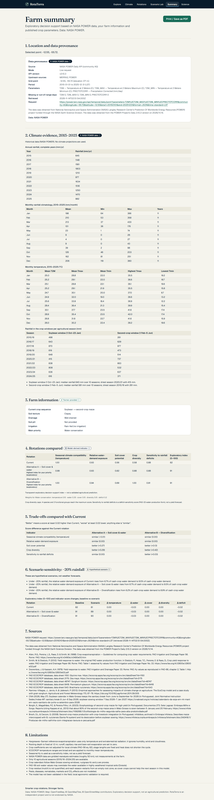

# RotaTerra

**Smarter crop rotations. Stronger farms.**

RotaTerra is an exploratory decision-support web app for soybean farms in the Brazilian Cerrado. For a point you choose, it retrieves eleven years (2015–2025) of daily NASA POWER rainfall and temperature, runs a documented FAO-56 soil-water balance for three crop rotations on the same field, and scores each one on five transparent indicators: temperature compatibility, water-demand exposure, soil cover, crop diversity and sensitivity to rainfall deficits. You can then test the rotations under hypothetical rainfall and temperature changes and open "Why this result?" to trace every number to its formula, input and source.

It is not a yield forecast, not a weather forecast and not a substitute for local agronomic advice.

Built for the NASA Space Apps Challenge 2026 ("Field Shift"). RotaTerra is an independent project: it uses NASA open data, is **not endorsed by or affiliated with NASA**, and uses no NASA or Space Apps logos.

## Screenshots

| Landing | Explore your farm |
|---|---|
|  |  |

| Climate charts | Rotation comparison |
|---|---|
|  |  |

| Scenario Lab | Summary |
|---|---|
|  |  |

More, including 375 px mobile views and the print layout: [`docs/screenshots/`](docs/screenshots/).

## Implemented / Conceptual (not implemented)

This is the single source of truth for scope; the other documents link here.

| Implemented in this MVP | Conceptual (not implemented) |
|---|---|
| Location by map click (MapLibre GL + OpenFreeMap) or latitude/longitude fields, validated and rounded to 2 decimals | Grid-cell outline on the map; reverse geocoding; multi-location comparison |
| Live NASA POWER Daily API request (T2M, T2M_MAX, T2M_MIN, PRECTOTCORR; 2015-01-01 to 2025-12-31; community AG) through `/api/power` | GPM IMERG precipitation and SMAP soil moisture (listed as future work, not integrated) |
| Three cache layers (client promise cache, HTTP `Cache-Control`, Next.js fetch `revalidate`) and a stored NASA POWER snapshot used only for the default Sorriso (MT) point when the live service fails | Server-side rate limiting; snapshots for other locations |
| Farm profile kept in the URL: current sequence (4 presets), soil texture, drainage, optional pH, irrigation, main priority | User accounts, saved farms, database |
| Climate page: annual rainfall, monthly rainfall climatology, monthly temperature and crop-window rainfall charts and a 3D month-by-year rainfall view, each with a data table | Climate projections (for example CMIP6); only the historical record is used |
| Daily FAO-56 model: Hargreaves–Samani ETo, Kc curves, soil-water balance with stress coefficient, optional refill irrigation | Penman–Monteith ETo; FAO-56 mulch / residue effects; soil-water carry-over between seasons; runoff and capillary rise |
| Three rotations (Current, Alternative A "Soil cover & water", Alternative B "Diversification") with five scored indicators, practical flags and a weighted exploratory index | Free rotation builder; more crops (for example cotton, crotalaria) |
| Fixed Mato Grosso calendar (soybean 1 Oct, second crop 1 Feb, ruzigrass until 10 Sep) | Editable soybean sowing date |
| "Why this result?" dialog with rules, categorised inputs, per-crop and per-season values, assumptions, limitations and sources | Explanations generated by AI (all explanations are deterministic templates) |
| Scenario Lab: rainfall −30% to +20%, temperature −2 °C to +4 °C, presets "Historical baseline" and "−20% rainfall (demo)" | Yield, profit or economic estimates; pest, disease and nematode modelling |
| Printable summary (browser print / Save as PDF) and a Science page with every formula and parameter | PDF generation library; translations (the app is English only) |
| Region guard: full results in Mato Grosso, illustrative banner elsewhere in Brazil, no rotation results outside Brazil | Field validation of the model |
| 53 Vitest unit tests for the model, parser, aggregation and URL state, plus 8 for the 3D rainfall view geometry | End-to-end browser tests in the repository |

## Requirements

- Node.js **≥ 22.12** (required by Vitest 5; tested with Node 22.14)
- npm (a `package-lock.json` is committed)
- Internet access for live NASA POWER data and map tiles

## Commands

```bash
npm ci                  # install the exact locked dependencies
npm run dev             # development server on http://localhost:3000
npm test                # unit tests (vitest run src)
npm run lint            # ESLint
npm run build           # production build
npm start               # serve the production build
npm run snapshot:power  # re-download the NASA POWER snapshot for Sorriso (MT) into data/power-snapshot.json
```

`npm run snapshot:power` overwrites `data/power-snapshot.json` only when NASA POWER answers successfully. After running it, run `npm test` again: the tests check that the stored request URL matches the one the app builds and that the series has 4018 days.

## Deploy on Vercel

No environment variables are needed.

- **Git import**: push the repository to GitHub/GitLab/Bitbucket, choose "Add New… → Project" in Vercel and import it. The Next.js preset, `npm run build` and the default output are detected automatically.
- **CLI**: run `npx vercel` in the project folder (and `npx vercel --prod` for production).

The `/api/power` route declares `maxDuration = 60` seconds and gives NASA POWER 25 seconds to answer.

## Project structure

```
src/
  app/
    page.tsx                 Landing page
    explore/ climate/ simulator/ scenarios/ science/   One page.tsx per screen
    summary/                 page.tsx + summary-view.tsx (printable report)
    api/power/route.ts       NASA POWER proxy with validation, caching and snapshot fallback
    layout.tsx error.tsx globals.css
  components/                Client views and shared UI (charts, tables, map, dialogs, badges)
    ui/                      shadcn/ui primitives
  lib/                       Pure TypeScript model (no React/Next imports) + *.test.ts
data/power-snapshot.json     Raw NASA POWER response for Sorriso (MT), used only as fallback
scripts/fetch-power-snapshot.mjs   Downloads that snapshot
public/maplibre-gl-worker.mjs      Copy of the MapLibre worker (see ARCHITECTURE)
docs/                        Documentation and screenshots
```

## Documentation

- [Architecture](docs/ARCHITECTURE.md)
- [NASA data sources](docs/NASA_DATA_SOURCES.md)
- [Methodology](docs/METHODOLOGY.md)
- [Limitations and future work](docs/LIMITATIONS_AND_FUTURE_WORK.md)
- [AI usage](docs/AI_USAGE.md)
- [Demo walkthrough](docs/DEMO_WALKTHROUGH.md)
- [Submission text](docs/SUBMISSION.md)

## Data acknowledgment

Climate data come from the NASA POWER project. The app shows the acknowledgment below in every provenance card, filled in with the API version and the retrieval date reported for the data being displayed (`powerAcknowledgment` in `src/lib/power.ts`):

> The data was obtained from National Aeronautics and Space Administration (NASA) Langley Research Center's Prediction Of Worldwide Energy Resources (POWER) project funded through the NASA Earth Science Division. The data was obtained from the POWER Project's Daily `<version>` version on `<YYYY/MM/DD>`.

For the stored snapshot this reads "…Daily 2.10.3 version on 2026/11/14."

Map tiles: [OpenFreeMap](https://openfreemap.org/), © OpenMapTiles, © OpenStreetMap contributors.

Crop parameters come from FAO publications (FAO-56, FAO-66/FAO-33) and the FAO ECOCROP database; the full list of sources is on the Science page and in [METHODOLOGY](docs/METHODOLOGY.md#sources).

## Disclaimer

RotaTerra is an independent project. It is not endorsed by, sponsored by or affiliated with NASA or the NASA Space Apps Challenge, and it does not use NASA or Space Apps logos. "Data: NASA POWER" credits the data source only. Results are exploratory and depend on stated assumptions; any change of rotation should be discussed with a local agronomist.
